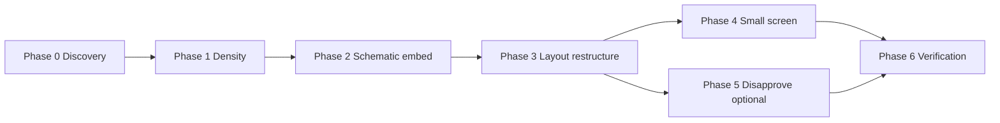

# Phase Plan 10 — Workspace Compact Unified UI

**Goal:** Redesign `/workspace` so a PM can **talk to an issue**, **see its schematic location**, and **approve agent dispatch** — all in one view, with smaller type and concise copy that stays readable on small screens.

**Repo:** `fridson-app/` only (separate git — commit inside `fridson-app/`)

**Depends on:** Phase 0 discovery below. Safe to run in parallel with vault doc work; do **not** touch agent edge functions or migrations.

---

## Phase 0: Documentation Discovery (READ FIRST)

### Current state (verified in code)

| Capability | Status | Location |
|------------|--------|----------|
| Issue list + selection | ✅ Shipped | `src/routes/workspace.tsx`, `IssueListPane`, `IssueRow` |
| Talk / chat | ✅ Exists but **buried** in Discuss tab | `WorkRecordPane.tsx` → `IssueDiscussChat` → `POST /api/chat` |
| Schematic | ✅ Separate route only | `src/routes/schematic.tsx`, `Floorplan.tsx` |
| Agent approval sidebar | ✅ Shipped | `AIDecisionPanel.tsx` → `approveReport` → `invokeResolutionAgent` |
| Disapprove | ❌ API exists, no UI | `lib/agent-invoke.server.ts` `invokeAgentDecision(..., "disapprove")` |

**Layout today** (`workspace.tsx:76`):

```
lg:grid-cols-[320px_1fr_380px]
  IssueListPane | WorkRecordPane (tabs: work/context/discuss) | AIDecisionPanel
```

Below `lg`, panes **stack vertically** — no small-screen operator spec exists in vault.

### Allowed APIs (copy from these — do not invent)

| API | Source | Signature / usage |
|-----|--------|-------------------|
| `listReports` | `lib/reports.functions.ts` | Used by workspace + schematic queries |
| `listMessages` | `lib/messages.functions.ts` | `{ data: { reportId } }` |
| `useChat` + `DefaultChatTransport` | `WorkRecordPane.tsx:244-248` | `api: "/api/chat"`, `body: { reportId }` |
| `approveReport`, `acknowledgeReport`, `retryReport` | `components/workspace/shared.ts` | Via `useWorkspaceMutations` |
| `invokeAgentDecision` | `lib/agent-invoke.server.ts:52-57` | Wire disapprove only if adding button |
| `Floorplan` | `components/schematic/Floorplan.tsx` | `selectedFloor`, `markers[]`, `className` |
| `spotForAsset`, `parseAssetLocation`, `FLOORS_ASCENDING` | `components/schematic/coords.ts` | Marker placement |
| `searchValidator` | `components/workspace/shared.ts:37-47` | `selected`, `group` search params |
| Design tokens | `src/styles.css` | `--font-sans`, urgency/status CSS vars |
| Typography density | `04-Resources/fridson/design-system.md` §6.5, §7, §8.1 | Compact rows, right AI panel |

### Anti-patterns (do NOT)

- Do **not** create a new `/issues/:id` route — selection stays on `/workspace?selected=&group=`
- Do **not** invent chat endpoints — reuse `/api/chat` and `listMessages`
- Do **not** duplicate floorplan SVG logic — embed `Floorplan`, copy marker builder from `schematic.tsx:85-120`
- Do **not** move approve logic out of `approveReport` / `useWorkspaceMutations`
- Do **not** use full-page modals for chat or schematic — side panels / in-pane splits per design system §6.5
- Do **not** increase font sizes for “ readability” — target **smaller** per user request

### Design references (vault)

- `04-Resources/fridson/design-system.md` — §5 `AIDecisionPanel`, §6.5 density, §8.1 shell
- `02-Projects/fridson/plans/08-ui-revamp-dribbble-support-dashboard.md` — Phase 4 workspace
- `02-Projects/fridson/plans/03-verify-live-demo-path.md` — schematic pinpoint verification
- `02-Projects/fridson/ui-revamp-update-2026-06-27.md` — shipped 3-pane layout baseline

---

## Target UX

### Desktop (`≥1024px`) — unified mission view

```
┌─────────────┬──────────────────────────────┬──────────────┐
│ Compact     │  Schematic (asset pin)       │ Agent        │
│ issue queue │  ─────────────────────────   │ approval     │
│ ≤48px rows  │  Discuss chat (always on)    │ (sticky top) │
└─────────────┴──────────────────────────────┴──────────────┘
     220px              flex 1                    280px
```

- **Left:** decision-first queue, narrower, one-line rows (asset · issue · status dot)
- **Center:** schematic for selected issue’s floor/asset **on top**; chat **always visible below** (no tab to find Discuss)
- **Right:** approval actions pinned at top (acknowledge, approve, retry); reasoning/contractors scroll below
- **Work record fields** (summary + instructions): compact collapsible block **inside approval panel** or thin strip above chat — not a separate tab

### Small screen (`<1024px`) — segmented overview

Use a **3-segment control** (or shadcn `Tabs` at page level) so only one primary pane fills the viewport:

| Segment | Content |
|---------|---------|
| **Queue** | `IssueListPane` full width |
| **Issue** | Schematic (top 40%) + chat (bottom 60%) |
| **Approve** | `AIDecisionPanel` full width |

Persist segment in URL: `?pane=queue|issue|approve` (extend `searchValidator`).

Default segment when `selected` is set: `issue`. When nothing selected: `queue`.

---

## Phase 1: Compact density tokens

**What to implement:** A workspace-scoped density pass — smaller fonts, tighter padding, shorter rows — without changing layout structure yet.

### Tasks

1. **Add workspace density utilities** in `src/styles.css` (or a `workspace-density.css` import):
   - `.ws-label` → `text-[9px] uppercase tracking-[0.2em] text-muted-foreground`
   - `.ws-body` → `text-xs leading-snug`
   - `.ws-meta` → `text-[10px] text-muted-foreground/80`
   - `.ws-section-pad` → `px-3 py-2` (replace `px-5 py-3` in workspace components)

2. **Apply to existing workspace components** (replace ad-hoc classes with tokens):
   - `IssueRow.tsx` — target row height ≤48px: `py-1.5`, title `text-xs font-medium`, drop redundant zone line on narrow list (zone in tooltip or second line only when selected)
   - `IssueListPane.tsx` — group headers `ws-label`, reduce select height
   - `MissionControlStrip.tsx` — single line; abbreviate labels on `md:` (`Urgent` not `Unacknowledged urgent`); `text-[10px]`
   - `AIDecisionPanel.tsx` — header `ws-body`, section labels `ws-label`, reasoning bullets `text-[11px]`
   - `WorkRecordPane.tsx` / `AppHeader` on workspace — reduce description verbosity

3. **Concise copy pass** — shorten visible strings:
   - AppHeader description: `"Triage · map · approve"` (not full sentence)
   - Empty states: one line + one hint (design-system §8.2)
   - KPI chips: icon + count only on `sm`, full label on `md+`

### Documentation references

- Copy label pattern from `IssueRow.tsx:37-47` (`text-[9px]` badges)
- Copy section label pattern from `AIDecisionPanel.tsx:86-88` (`text-[10px] uppercase tracking-[0.18em]`)
- Density rules: `design-system.md` §6.5, §7

### Verification checklist

- [ ] `IssueRow` computed height ≤48px at 1280×800
- [ ] No workspace panel uses `text-sm` for body copy except chat bubbles
- [ ] `pnpm exec tsc --noEmit` passes
- [ ] Visual check at **1024×768** and **390×844** (operator sidebar collapsed)

### Anti-pattern guards

- Do not change global `html` font-size — scope to workspace route wrapper only (`className="workspace-compact"` on root div in `workspace.tsx`)

---

## Phase 2: Extract schematic embed component

**What to implement:** Reusable `IssueSchematicEmbed` that shows the selected report’s asset on the floorplan — copy marker logic from the schematic route, do not reimplement.

### Tasks

1. **Create** `src/components/workspace/IssueSchematicEmbed.tsx`:
   - Props: `report: ReportWithAsset | null`, optional `className`
   - Copy marker assembly from `schematic.tsx:85-120` (open reports + highlight selected asset as `variant: "primary"`)
   - Copy floor selection from `schematic.tsx:63-83` — default floor from `spotForAsset(report.asset_id).location.floor`
   - Render `Floorplan` with `selectedFloor` + `markers`; height via `className` (caller sets `min-h-[180px] h-[38%]` etc.)
   - Floor picker: compact icon buttons copied from `schematic.tsx` floor selector section (read full file for exact JSX)

2. **Keep `/schematic` route unchanged** — embed is for workspace only.

### Documentation references

- `Floorplan` props: `components/schematic/Floorplan.tsx:23-33`
- Marker types: `FloorMarker.variant` — `"primary" | "report" | "asset"`
- Coords: `components/schematic/coords.ts` — `spotForAsset`, `FLOORS_ASCENDING`, `DEFAULT_FLOOR`

### Verification checklist

- [ ] Select issue in workspace → pin appears on correct floor
- [ ] Switch issue → floor auto-jumps if different
- [ ] Empty report → placeholder “Select an issue to locate on map”
- [ ] Grep: no duplicate `PLAN_WIDTH` / SVG logic outside `Floorplan.tsx`

### Anti-pattern guards

- Do not fetch reports twice — reuse `reportsQuery` from workspace loader or pass markers from parent

---

## Phase 3: Restructure workspace layout (talk + map + approve)

**What to implement:** Replace center `WorkRecordPane` tab model with schematic + always-on chat; keep approval on the right.

### Tasks

1. **Create** `src/components/workspace/IssueCenterPane.tsx`:
   - Top: compact evidence strip (one line: issue label · zone · urgency badge · status — copy from `WorkRecordPane` `EvidenceSection`, condense to single row)
   - Middle: `<IssueSchematicEmbed report={report} className="min-h-[160px] flex-[2]" />`
   - Bottom: lift `IssueDiscussChat` from `WorkRecordPane.tsx:218-351` **verbatim** into this pane with `flex-[3] min-h-0`
   - Optional collapsible “Brief” drawer for summary/instructions fields (copy textarea block from `WorkRecordPane.tsx:97-115`)

2. **Refactor** `WorkRecordPane.tsx`:
   - Extract `IssueDiscussChat` to `IssueDiscussChat.tsx` (same file or sibling)
   - Extract `EvidenceSection` + brief fields to shared exports if needed by `IssueCenterPane`
   - Remove Discuss tab; keep Context tab content available via collapsible “Stakeholder context” in center pane **or** defer to Phase 5

3. **Update** `src/routes/workspace.tsx`:
   - Replace `<WorkRecordPane … />` with `<IssueCenterPane … />`
   - Adjust grid: `lg:grid-cols-[220px_1fr_280px]`, add wrapper `className="workspace-compact"`
   - Pass brief/mutation props to both `IssueCenterPane` (brief edit) and `AIDecisionPanel` (approve gate)

4. **Refactor** `AIDecisionPanel.tsx` for approval-first sidebar:
   - Sticky footer or top block: Acknowledge + Approve + Retry buttons (copy `AIDecisionPanel.tsx:98-174`)
   - Move brief summary/instructions inputs here **above** approve button when `canApprove` (reduces center clutter)
   - Collapse research report + contractors behind `<Collapsible>` default closed
   - Truncate duplicate alert to one line

5. **Extend** `searchValidator` in `shared.ts`:
   - Add optional `pane?: "queue" | "issue" | "approve"` for mobile segment

6. **Mobile segment shell** in `workspace.tsx`:
   - Below `lg`: render segment `Tabs` instead of 3-column grid
   - Copy tab list pattern from `WorkRecordPane.tsx:67-79` but at page level
   - When user selects issue from queue, auto-switch to `pane=issue`

### Documentation references

- Grid shell: `workspace.tsx:64-107`
- Chat wiring: `WorkRecordPane.tsx:218-351`, `routes/api/chat.ts`
- Approval mutations: `shared.ts` `useWorkspaceMutations`
- Layout pattern: `design-system.md` §8.1 (queue + decision panel)

### Verification checklist

- [ ] Discuss chat sends/receives without opening a tab
- [ ] Schematic visible when issue selected (desktop)
- [ ] Approve button visible without scrolling on 1280×800 (brief fields filled)
- [ ] Mobile: 3 segments switch without losing `selected` report
- [ ] Deep link `/workspace?selected={id}` still works

### Anti-pattern guards

- Do not remove `StakeholderContextPanel` — collapse or move, don’t delete
- Do not change `/api/chat` request shape

---

## Phase 4: Small-screen polish + overview mode

**What to implement:** Ensure “clear overview” on small screens and ultra-wide density.

### Tasks

1. **Queue overview mode** on `IssueListPane`:
   - Hide group section headers when `group === "flat"` default for mobile
   - Show only: urgency dot · asset · issue (truncated) · status pill — hide timestamp below `md`

2. **MissionControlStrip** responsive:
   - `hidden sm:flex` for low-priority chips when 0 count
   - Stack to 2×2 grid below `sm` if needed

3. **Schematic embed** on mobile:
   - Reduce min-height to `120px` in Issue segment
   - Floor picker: horizontal scroll chips `text-[10px]`

4. **Chat input** on mobile:
   - Sticky bottom within Issue segment; `pb-safe` for iOS
   - Reduce bubble padding `px-2.5 py-1.5 text-xs`

5. **Fix** `RecentTicketsFeed` link (`components/support/RecentTicketsFeed.tsx:33`):
   - Change `/?selected=` → `/workspace?selected=` (orthogonal but same sprint)

### Verification checklist

- [ ] Usable at **390×844**: queue → select → issue segment shows map + chat → approve segment shows buttons
- [ ] No horizontal scroll on workspace
- [ ] Touch targets ≥40px for approve/acknowledge (can use `size="sm"` with min-height override)

---

## Phase 5 (optional): Disapprove + context drawer

**What to implement:** Complete approval loop and preserve stakeholder context without tabs.

### Tasks

1. Wire **Disapprove** button when `report.status === "awaiting_approval"`:
   - Add server fn wrapper calling `invokeAgentDecision(reportId, "disapprove")` (pattern from `approveReport` in `reports.functions.ts`)
   - Button in `AIDecisionPanel` sticky action block

2. **Stakeholder context** as sheet/drawer from center pane header (copy `StakeholderContextPanel.tsx`)

### Verification checklist

- [ ] Disapprove updates report status (or triggers agent path per INTERFACES)
- [ ] Context drawer opens without leaving workspace

---

## Phase 6: Verification (FINAL)

### Doc conformance

- [ ] Layout matches `design-system.md` §8.1: queue + main + right decision panel
- [ ] Density matches §6.5: compact rows, no full-page modals
- [ ] Empty states match §8.2 tone

### Grep checks

```bash
cd fridson-app
# No orphaned Discuss tab as primary chat entry
rg "TabsTrigger value=\"discuss\"" src/components/workspace

# Schematic embed uses Floorplan, not inline SVG
rg "IssueSchematicEmbed" src
rg "PLAN_WIDTH" src/components/workspace  # should be empty

# Mobile pane param wired
rg "pane" src/components/workspace/shared.ts src/routes/workspace.tsx
```

### Manual test script

1. Open `/workspace` — queue loads, compact rows
2. Select urgent unacknowledged report — schematic pin + chat + acknowledge visible
3. Send chat message — persists on reload
4. Fill brief → Approve & dispatch — status moves to researching
5. Resize to 390px — segment control works
6. Open `/schematic` — full-page schematic still works independently

### Build

```bash
cd fridson-app && pnpm exec tsc --noEmit && pnpm run build
```

---

## File touch list (expected)

| File | Phase |
|------|-------|
| `src/styles.css` | 1 |
| `src/components/workspace/IssueRow.tsx` | 1 |
| `src/components/workspace/IssueListPane.tsx` | 1, 4 |
| `src/components/workspace/MissionControlStrip.tsx` | 1, 4 |
| `src/components/workspace/AIDecisionPanel.tsx` | 1, 3, 5 |
| `src/components/workspace/IssueSchematicEmbed.tsx` | 2 **new** |
| `src/components/workspace/IssueDiscussChat.tsx` | 3 **extract** |
| `src/components/workspace/IssueCenterPane.tsx` | 3 **new** |
| `src/components/workspace/WorkRecordPane.tsx` | 3 refactor/shrink |
| `src/components/workspace/shared.ts` | 3 (`pane` search param) |
| `src/routes/workspace.tsx` | 1, 3, 4 |
| `src/components/support/RecentTicketsFeed.tsx` | 4 fix |

---

## Execution order



Each phase is **self-contained** — start a new agent session with: “Execute Phase N of `plans/10-workspace-compact-unified-ui.md`”.

---

## Known gaps (post-plan)

- Operator workspace on tablet landscape (768–1023px): segment vs 2-column — tune in Phase 4 QA
- Merge/link duplicate UI not in scope (follow-up from ui-revamp-update)
- `/support` vs `/dashboard` canonical nav — out of scope
